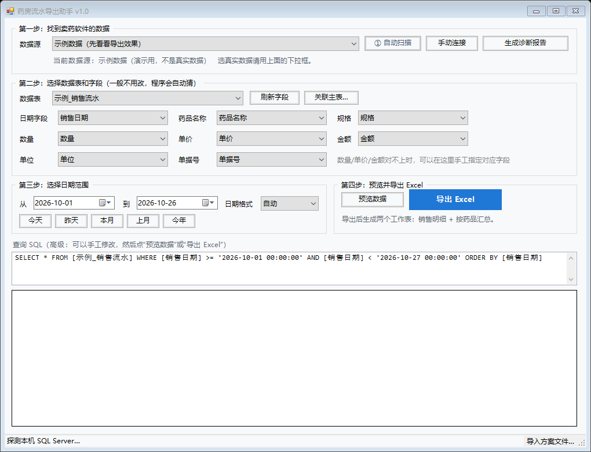

# 药房流水导出助手（DrugFlow）

一个 Windows 小工具：把卫生站 / 药店卖药软件里的**药品销售流水**，按日期范围导出成 Excel。
不依赖 Office、不联网、单个 exe 双击即用。



## 为什么做这个

卫生站日常看病 + 卖药，流水都记在那套卖药软件里。软件自带的“导出”要求 Excel 2009，
机器上装不了也打不开；一个月几百上千条手工抄不现实。

这个工具**绕开软件自带的导出**，直接读它背后的数据库，自己生成 `.xlsx`。

## 能做什么

- 按起止日期取数，只导这段时间的流水
- 导出两个工作表：**销售明细**（逐笔）+ **按药品汇总**（品种、数量、金额、笔数）
- 自动扫描本机数据库，自动猜表名和字段（日期 / 药品 / 规格 / 数量 / 单价 / 金额 / 单位 / 单据号）
- 销售单头和药品明细分成两张表的，可用“关联主表”按主表日期筛选
- 日期存成文本（`20260124`、`2026/01/24`）时，可切换日期格式
- 导出前预览，SQL 可看可改
- 方案保存 / 导入：下次一键复用，或换台电脑直接导入 `.ini`
- 扫描不到时生成诊断报告（表名、字段名、驱动、服务状态；不含药品与顾客数据）

## 支持的数据源

| 类型 | 接入方式 | 备注 |
|---|---|---|
| SQL Server | `System.Data.SqlClient`，失败自动改用 ODBC | 支持 Windows 认证与 SQL 账号 |
| Access | ACE / Jet OLE DB | `.mdb` / `.accdb` |
| SQLite | `winsqlite3.dll`（Win10/11 自带）或软件目录的 `sqlite3.dll` | `DllImport`，无第三方库 |
| DBF | 系统 dBASE ODBC 驱动 | dBASE / FoxPro |
| 任意 ODBC | `System.Data.Odbc` | Firebird / MySQL 等，需本机装驱动 |

还会读取软件安装目录配置文件里的 SQL Server 连接串（含账号密码，界面与报告里打码显示）。

## 编译

要求：Windows 7/10/11 + .NET Framework 4.x（Win10/11 自带）。**不需要 SDK、不需要联网、不需要 NuGet。**

```powershell
powershell -ExecutionPolicy Bypass -File build.ps1
```

产物：`dist\DrugFlow.exe`（约 110 KB，32 位）。

编译脚本直接用系统自带的 `csc.exe`：

```
%WINDIR%\Microsoft.NET\Framework\v4.0.30319\csc.exe
  /target:winexe /platform:x86 /optimize+ /codepage:65001
  /r:System.dll /r:System.Core.dll /r:System.Data.dll
  /r:System.Drawing.dll /r:System.Windows.Forms.dll
  src\*.cs
```

这样选的原因：目标电脑可能很老、可能没网，不能要求装 .NET SDK 或运行时包；
程序也只用 .NET 4.0 就有的 API，Win7 能跑。

## 使用

1. 双击 `DrugFlow.exe`，等几秒自动扫描
2. “数据源”里选真实那个（示例数据只是演示）
3. 确认“数据表 / 字段映射”，选日期，点“预览数据”
4. 点“导出 Excel”

详细操作见 [docs/使用说明.txt](docs/使用说明.txt)。

## 方案文件

`.ini` 格式，放在 `%APPDATA%\DrugFlow\profiles\`，或在程序里点“导入方案文件…”：

```ini
name=XX药房
kind=sqlserver
connection=Data Source=192.168.1.10;Initial Catalog=DrugDB;User ID=sa;Password=***
table=dbo.SaleDetail
drug=药品名称
qty=数量
amount=金额
joinMaster=dbo.SaleMaster
joinDetailKey=单据号
joinMasterKey=单据号
joinDate=销售日期
dateStyle=ymd
```

## 诊断报告

程序会把软件线索、安装目录、数据库位置、表名与字段名写进一个 txt（保存到“文档”）。
报告**不包含**药品明细和顾客信息，可以安全地发给帮忙排查的人。

## 目录结构

```
src/          源码（13 个 .cs）
build.ps1     编译脚本
docs/         截图与用户手册
dist/         编译产物（.gitignore 里排除）
```

## 已知限制

- 没有在真实的卖药软件上验证过，只验证了造的测试库；实际软件的表结构可能需要一份方案文件适配
- 只做只读查询，不改原始数据；数据库账号需要有读权限
- 日期字段的文本格式要手动选（默认 `自动`）
- 主表关联只支持两张表；更复杂的结构需要在 SQL 框里手写

## 关于杀毒软件误报

未签名的小 exe 容易被 360 / 火绒 / 管家 的启发式规则拦（报“未知程序”“风险程序”），
这个项目不联网、不写开机启动、不注入进程、不枚举其它进程，属于误报。

可以这样缓解：

1. 加信任目录（360：木马查杀 → 信任区 → 添加目录）
2. 提交误报申诉，附上本仓库地址说明用途
3. 自行编译：本机生成的 exe 没有云端“陌生文件”记录
4. 购买代码签名证书（唯一能让“换任何电脑都不弹”的办法）

需要说明：**开源本身不能消除误报**，它的作用是让人能审查代码、也让误报申诉更有说服力。

## 许可证

[MIT](LICENSE)
